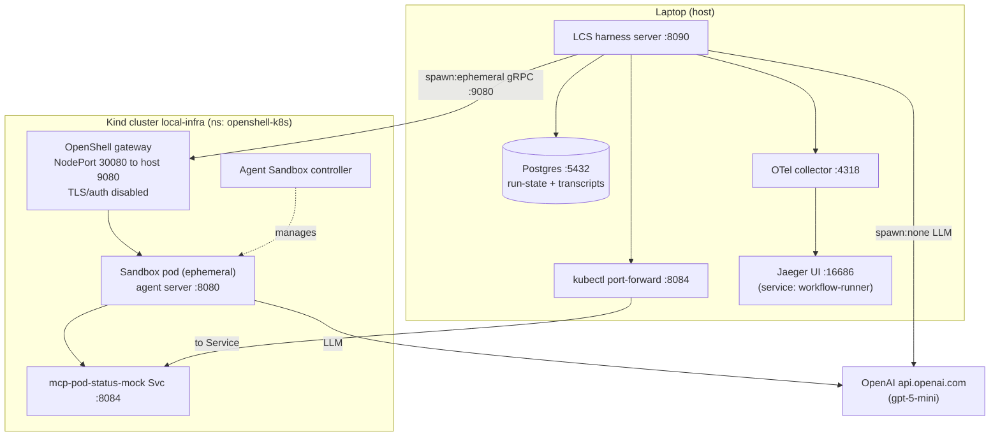

# Cloud-agents demo environment: from-scratch bring-up

Everything needed to stand up the environment behind
`docs/cloud-agents-demo-curl.sh` / `docs/cloud-agents-demo-playbook.md`
using only public repos. Written for both humans and AI agents: each step
is a copy-pasteable command with its success criterion.

## Inventory

| Piece | Source | Notes |
|---|---|---|
| lightspeed-stack (this repo, branch `harness-uie-demo-1`) | fork | Tracks `lightspeed-core/lightspeed-cloud-agents` branch `harness-uie-demo-1` by name (see row below); `uv.lock` records the exact resolved commit. |
| lightspeed-cloud-agents | `lightspeed-core/lightspeed-cloud-agents` branch `harness-uie-demo-1` (a110214 + fixes for [lightspeed-core#274](https://github.com/lightspeed-core/lightspeed-cloud-agents/issues/274)) | Tracks the branch tip: new cloud-agents fixes land with `uv lock --upgrade-package lightspeed-cloud-agents && uv sync` (plain `uv sync` keeps the locked commit). Re-run `make demo-agents-workflows-all` after any upgrade. You do not need to clone it unless developing on it. |
| Kind cluster + OpenShell gateway + Agent Sandbox controller | [`infra4dev`](https://github.com/jameswnl/infra4dev) | Gateway listens on `localhost:9080` (NodePort 30080 -> hostPort 9080), TLS/auth disabled. |
| Mock pod-status MCP server | infra4dev (`mcp-pod-status-mock/`) | Deterministic K8s tools for the demo scenarios; deployed into the gateway namespace. |
| Observability (OTel collector + Jaeger) | infra4dev (`podman-obs-up`) | OTLP at `:4317`/`:4318`, Jaeger UI at `:16686`. |
| Agentic sandbox image | `quay.io/jameswong/lightspeed-agentic-sandbox:latest` (public, multi-arch) | Mutable tag -- if a freshly pulled `latest` misbehaves, suspect drift; source is the public `lcs-main` branch of the sandbox fork. |
| Postgres | local | Native install or the `postgres` service in this repo's `docker-compose-harness.yaml`. |

## Architecture



How the three spawn modes flow through it:

| Mode | Agent runs | LLM call | MCP tools reach |
|---|---|---|---|
| `none` | in-process in LCS | direct to OpenAI | `localhost:8084` (the port-forward) |
| `local` | subprocess on host | direct to OpenAI | `localhost:8084` (the port-forward) |
| `ephemeral` | sandbox pod in Kind | from inside the pod | `mcp-pod-status-mock:8084` (in-cluster DNS) |

Workflows add Postgres persistence (run-state, per-step transcripts) and
the human-approval pause on top of the same per-step paths; traces from
all modes land in Jaeger under the service name `workflow-runner`.

## Prerequisites

- macOS with Podman (`podman machine`), `kind`, `helm`, `kubectl`, `uv`,
  `jq`, `curl`
- `OPENAI_API_KEY` exported (a real key; the demo calls gpt-5-mini)

## 1. Cluster + gateway + MCP mock (infra4dev)

```bash
git clone git@github.com:jameswnl/infra4dev.git ~/ws/infra4dev
cd ~/ws/infra4dev

podman machine start
export KIND_EXPERIMENTAL_PROVIDER=podman   # Podman-backed Kind

make kind-openshell-up        # Kind cluster + Agent Sandbox CRDs/controller + OpenShell gateway
make kind-mcp-pod-status-up   # build + kind-load + deploy the mock MCP server
```

Success criteria:

```bash
nc -z localhost 9080 && echo gateway-ok
kubectl --kubeconfig kind/kubeconfig -n openshell-k8s get deploy mcp-pod-status-mock
```

Port-forward the mock for the in-process (`agent-none`/`agent-local`)
scenarios -- run this in a terminal you keep open:

```bash
kubectl --kubeconfig kind/kubeconfig -n openshell-k8s \
  port-forward svc/mcp-pod-status-mock 8084:8084
```

Why the namespace matters: sandbox pods resolve the MCP server by its
short service name (`mcp-pod-status-mock:8084`) via same-namespace DNS.
The manifest and Makefile targets deploy it into `openshell-k8s` (the
gateway/sandbox namespace) for exactly this reason; moving it anywhere
else breaks every `spawn: ephemeral` scenario with an opaque
"Could not reach MCP server" agent error.

## 2. Observability

```bash
cd ~/ws/infra4dev
make podman-obs-up
```

Success criteria: `curl -s localhost:16686/api/services` responds; OTLP
receiver listens on `4318`.

## 3. Postgres

Either a native Postgres on `localhost:5432` with user/password/database
`lightspeed`:

```bash
psql -h localhost -U lightspeed -d lightspeed -c 'select 1'
```

or, if port 5432 is free:

```bash
podman compose -f docker-compose-harness.yaml up -d --wait postgres
```

Note: `make demo-agents-workflows-server` unconditionally runs that
compose command -- if you have a native Postgres on 5432 it fails on the
port conflict, so start the stack directly instead (next step).

## 4. lightspeed-stack (harness config)

```bash
cd <this repo>
uv sync --group dev --group llslibdev   # installs cloud-agents at the immutable rev pin a5b30eb

export OPENAI_API_KEY=...
export OPENSHELL_GATEWAY_URL=localhost:9080
export OPENSHELL_ALLOW_INSECURE_CREDENTIALS=1   # local gateway runs TLS-disabled
export OTEL_SDK_DISABLED=false
export OTEL_EXPORTER_OTLP_ENDPOINT=http://localhost:4318
export OTEL_EXPORTER_OTLP_PROTOCOL=http/protobuf
export OTEL_SERVICE_NAME=lightspeed-core-demo

uv run make run-stack CONFIG=lightspeed-stack-harness.yaml
```

"Failed to connect to Llama Stack ... degraded mode" at startup is
expected and harmless (cloud-agents never touches Llama Stack). Wait for
`Uvicorn running on http://0.0.0.0:8090`.

Spans are exported under the Jaeger service name **`workflow-runner`**
(hardcoded by cloud-agents' `init_tracing`), regardless of
`OTEL_SERVICE_NAME`.

## 5. Validate

From another terminal:

```bash
curl -s http://localhost:8090/v1/agent-tools | jq          # discover
make demo-agents-workflows SCENARIO=agent-none             # fast in-process check
make demo-agents-workflows SCENARIO=agent-ephemeral        # real sandbox (first call pulls ~500 MB image)
make demo-agents-workflows-all                             # full matrix
```

## Troubleshooting (environment is broken -- fix and retry)

- `agent-none` / `agent-local` fail with
  `"error": "Client failed to connect: All connection attempts failed"`:
  the MCP mock port-forward died. It runs as a foreground `kubectl
  port-forward` that exits silently (terminal closed, laptop slept,
  kubeconfig changed). Check and re-establish it:

  ```bash
  nc -z -w 2 localhost 8084 || kubectl --kubeconfig ~/ws/infra4dev/kind/kubeconfig \
    -n openshell-k8s port-forward svc/mcp-pod-status-mock 8084:8084
  ```

  (`agent-ephemeral` is unaffected -- sandboxes reach the mock via
  in-cluster DNS, not the port-forward.)

- First `agent-ephemeral` call seems hung for a minute: it is pulling the
  ~500 MB sandbox image into the fresh Kind node. Watch progress with
  `kubectl --kubeconfig ~/ws/infra4dev/kind/kubeconfig -n openshell-k8s
  get pods` -- a new sandbox pod in `ContainerCreating`/`ImagePullBackOff`
  means it is working. Subsequent calls run in ~10-20 s.

## Teardown

```bash
# LCS: Ctrl-C the uvicorn process; kill the port-forward
cd ~/ws/infra4dev && make kind-down       # deletes the cluster
make podman-obs-down                       # stops OTel + Jaeger
podman machine stop                        # optional
```

## Known flakes (environment is fine -- rerun the scenario)

- ~~`workflow-ephemeral-approval` completing with the `remediate` step
  seeing the literal `{{ steps.triage_result... }}` template~~ — **fixed**
  by the pinned fork commit ([lightspeed-core#274](https://github.com/lightspeed-core/lightspeed-cloud-agents/issues/274)):
  ephemeral steps now receive the interpolated prompt. Verified on the
  full matrix; no literal template in any remediate transcript.
- ~~Generic `agent returned success=false` hiding the real sandbox error~~ —
  **fixed** by the same commit: failures now surface the sandbox's
  `summary` (e.g. `Agent error: Failed to connect to MCP server ...`).
